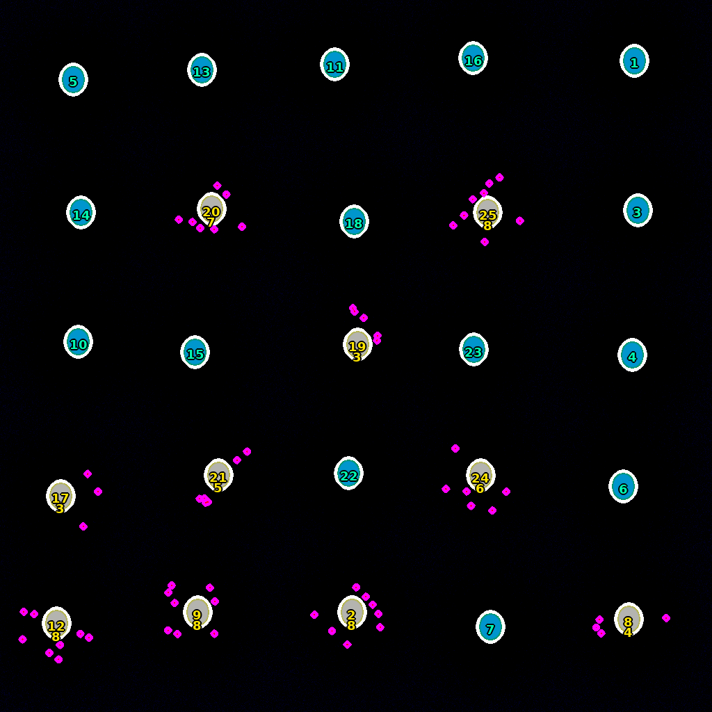

# TCruzi Analyzer

Desktop application for the automated quantification of *Trypanosoma cruzi* infection in fluorescence microscopy images. From two-channel images (a nuclear stain such as DAPI/Hoechst plus a fluorescent parasite reporter), it segments host-cell nuclei, detects intracellular amastigotes, assigns them to individual cells and reports the **percentage of infected cells** and the **number of amastigotes per cell**. It processes whole batches and exports a formatted Excel report.

I designed and developed the tool to replace manual counting of infected cells. It was built and tested on DAPI/DsRed images of infected cell cultures at early (2 hpi) and late (72 hpi) infection.



*Overlay produced by the pipeline on the synthetic test image (see [Validation](#validation-on-a-synthetic-image)). Infected cells are labelled in yellow with their amastigote count, uninfected nuclei are shown in cyan, and detected amastigotes in magenta.*

## Pipeline

1. **Input and channels.** Reads TIF and Nikon ND2 files. For ND2 files, the nuclear and parasite channels are detected automatically from the channel names. The parasite signal can come from one or several channels (e.g. red and green combined).
2. **Optional cleaning** (`limpiador_imagenes.py`, enabled by default in the GUI):
   - background subtraction;
   - adaptive contrast enhancement (CLAHE) and mild denoising;
   - standardisation of every image to a common layout: nuclei in blue, amastigotes in red, whichever colour they had originally.
3. **Nucleus segmentation:**
   - **On GPU:** [CellPose](https://github.com/MouseLand/cellpose), compatible with both 2.x and 4.x/cpsam. The nucleus diameter is estimated from the image. If CellPose finds clearly fewer nuclei than a classical estimate, it retries with more sensitive settings.
   - **On CPU:** a fast classical watershed segmentation is used by default (`CPU_FAST_NUCLEI = True`). This takes seconds instead of minutes, so the tool can run on lab computers without a GPU.
   - In both modes, merged nuclei are split and faint nuclei that were missed are rescued.
4. **Amastigote detection:**
   - Detection uses a classical adaptive threshold (several candidate methods, plus a size filter) or CellPose. In automatic mode, the method is chosen according to how dense the signal is.
   - The area of a single amastigote is **calibrated automatically** from isolated parasites, with a confidence score. Dense parasite masses are then counted by area.
5. **Assignment to cells**, in three passes:
   1. Each amastigote goes to the nearest nucleus (KD-tree), within a cytoplasmic radius bounded by the neighbouring cells.
   2. Free amastigotes that are in physical contact with a cluster already assigned to a cell join that cell (contiguity).
   3. Remaining amastigotes close to a cell are assigned within an extended radius.

   Truly isolated background signal is left unassigned.
6. **Output:**
   - per-cell table (infected or not, amastigote count, sparse, cluster or dense mode);
   - infection percentage and an overlay image for visual quality control;
   - Excel report with a summary sheet and one sheet per image, including overlays and charts.

## Graphical interface

`gui.py` is a Tkinter application. It provides:

- batch loading of images and the optional cleaning step;
- an overlay viewer and a per-image results table;
- **parameter profiles**, stored in `%APPDATA%\TCruzi Analyzer` on Windows or `~/.tcruzi_analyzer` elsewhere;
- a hardware selector (auto / CPU / GPU);
- Excel export.

The interface and code comments are in Spanish.

## Validation on a synthetic image

`demo/synthetic_demo.py` generates an image with a known ground truth and runs the full pipeline in CPU mode. The image has 25 host cells; 10 of them are infected with 3–8 amastigotes each, giving 63 amastigotes in total.

| | Ground truth | Detected |
|---|---|---|
| Cells | 25 | 25 |
| Infected cells | 10 | 10 |
| Infection (%) | 40.0 | 40.0 |
| Amastigotes | 63 | 60 |
| Cells with exact amastigote count | – | 23 / 25 |

The run takes about 2 s on CPU. This is a software sanity check of the pipeline, not a biological validation. Real microscopy images are noisier and are not included here.

## Installation

```bash
git clone https://github.com/jcleonmiguel/tcruzi-analyzer.git
cd tcruzi-analyzer
pip install -r requirements.txt   # Python 3.10–3.11 recommended
```

For GPU acceleration, install a **CUDA-enabled PyTorch** before installing CellPose (see [pytorch.org](https://pytorch.org/get-started/locally/)).

## Usage

```bash
python gui.py                              # graphical interface
python demo/synthetic_demo.py              # synthetic sanity check (no GPU or data needed)
python limpiador_imagenes.py <folder>      # clean a folder of images from the command line
```

The analysis can also be called from Python:

```python
from analyzer import run_analysis
out = run_analysis("image.tif", blue_ch_idx=2, red_ch_idx=0, hardware_mode="auto")
print(out["results"]["infection_pct"], out["results"]["infected_cells"])
```

## GPU vs CPU

- **Running from source with a CUDA-enabled PyTorch:** GPU mode uses CellPose for nuclei.
- **The packaged Windows build** (PyInstaller + Inno Setup, not included in this repository) **runs in CPU mode only.** GPU mode did not work in the installed program. CPU mode with fast watershed segmentation is the supported configuration there.
- If GPU mode is selected and no usable CUDA device is found, the analyzer now **falls back to CPU** instead of failing.

## Limitations

- Default thresholds and size ranges were tuned on images from a single lab setup. Other microscopes or staining protocols may need parameter adjustment; saved profiles make this easier.
- The CPU watershed segmentation works well for rounded nuclei. For irregular or tightly packed nuclei, CellPose on GPU is more robust.
- The repository includes no benchmark against manual counts on real images, because the lab images are not public.

## Repository structure

```
├── analyzer.py             # analysis pipeline (segmentation, detection, assignment, overlay)
├── gui.py                  # Tkinter desktop interface, batch processing and Excel export
├── limpiador_imagenes.py   # image cleaning / standardisation (GUI step or command line)
├── profile_manager.py      # saved parameter profiles
├── demo/synthetic_demo.py  # synthetic ground-truth test
└── docs/                   # figures for this README
```

## Author and licence

José Carlos León Miguel — [github.com/jcleonmiguel](https://github.com/jcleonmiguel)

Released under the MIT License (see `LICENSE`).
