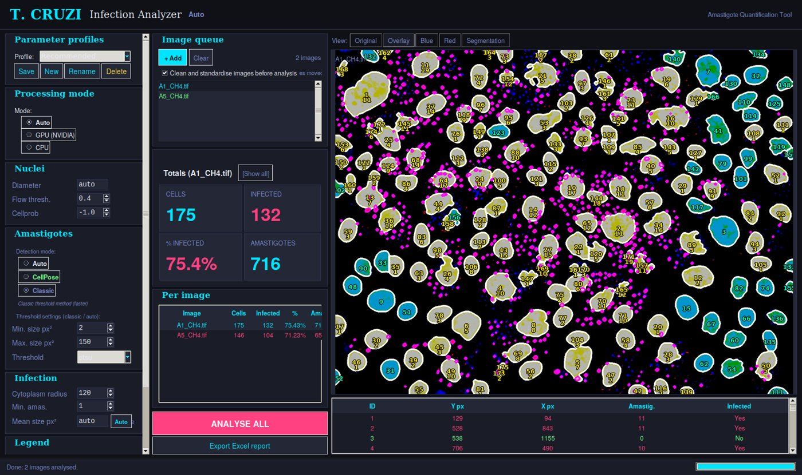
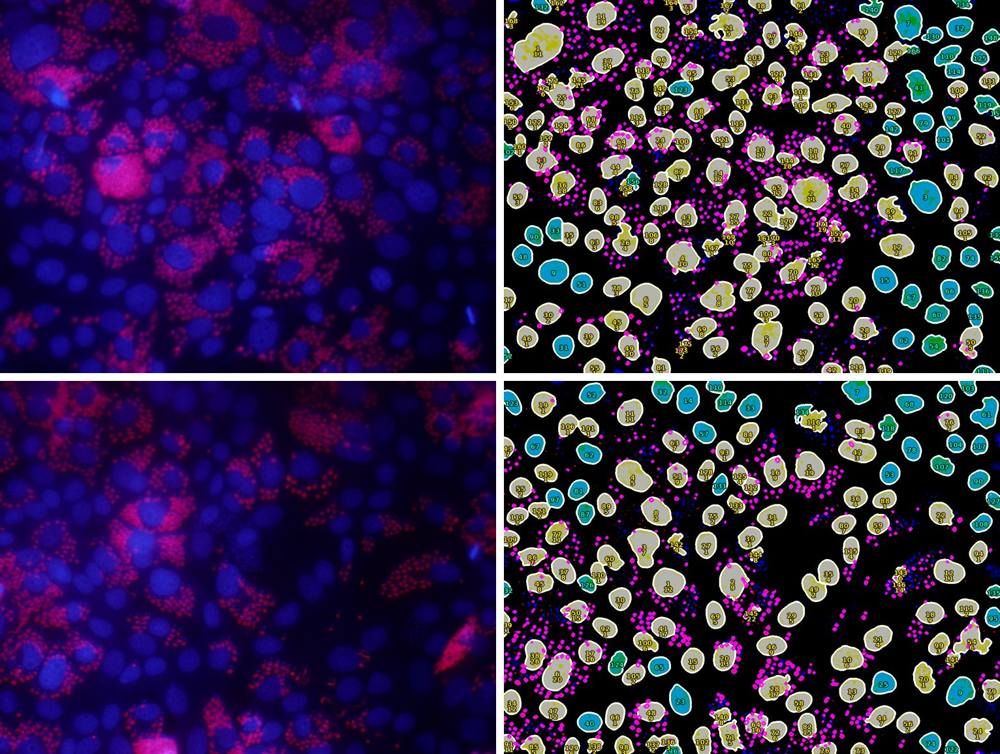

# TCruzi Analyzer

Desktop tool that quantifies *Trypanosoma cruzi* infection in fluorescence microscopy images. Each image has two channels: nuclei (DAPI/Hoechst) and a parasite reporter. From them the tool segments the host-cell nuclei, finds the intracellular amastigotes, assigns each one to a cell, and reports the **percentage of infected cells** and the **amastigotes per cell**. It works on whole batches and exports an Excel report.

I wrote it at the request of the Department of Parasitology of the University of Granada, to replace counting infected cells by hand.



## Example

These are two images of infected cultures from the lab, included in `examples/`. Each row shows the original image on the left and the analysis overlay on the right.



In the overlay:
- infected cells have a yellow nucleus;
- uninfected nuclei are blue-green;
- detected amastigotes are magenta;
- each nucleus is labelled with its ID and its amastigote count.

| Image | Cells | Infected | Infected (%) | Amastigotes |
|---|---|---|---|---|
| A1_CH4 | 175 | 132 | 75.4 | 716 |
| A5_CH4 | 146 | 104 | 71.2 | 658 |

To reproduce them, run `python examples/run_examples.py`. It applies the same settings as the GUI defaults (cleaning on, classic detection) and takes a few seconds per image on CPU.

## How it works

1. **Channels.** It reads TIF and Nikon ND2 files. For ND2, the nuclear and parasite channels are picked from the channel names. The parasite signal can come from one channel or from several combined (e.g. red and green).
2. **Cleaning** (`image_cleaner.py`, on by default in the GUI):
   - background subtraction, CLAHE and light denoising;
   - every image is rewritten in one layout: nuclei in blue, parasites in red, whatever colour they had originally;
   - amastigotes that picked up the DNA stain and show up only in blue are moved to the parasite channel. Otherwise they would cluster into fake nuclei.
3. **Nuclei.**
   - On a GPU, nuclei are segmented with [CellPose](https://github.com/MouseLand/cellpose), versions 2.x or 4.x (cpsam). If it finds clearly fewer nuclei than a quick classic estimate, it retries once with more sensitive settings.
   - On CPU, a classic watershed is used instead. It takes seconds rather than minutes, which is what made the tool usable on the lab computers.
   - Both paths then split merged nuclei and recover faint ones that were missed.
4. **Amastigotes.**
   - They are detected with an adaptive threshold (or with CellPose, if asked), using a size filter.
   - The area of a single amastigote is calibrated on each image from isolated parasites.
   - Dense masses in late infections are estimated from their area. Small spots are counted one by one.
5. **Assignment to cells**, in three passes:
   1. each amastigote goes to the nearest nucleus, within a cytoplasm radius limited by the neighbouring cells;
   2. free amastigotes touching an already assigned cluster join that cell;
   3. the ones still close to a cell are assigned within a wider radius.

   Isolated background signal stays unassigned.
6. **Output.** A per-cell table, the infection percentage, the overlay, and an Excel report with a summary sheet plus one sheet per image, including images and charts.

## Interface

`gui.py` (Tkinter) gives you:
- an image queue with the optional cleaning step;
- the viewer (original, overlay, single channels, segmentation) with per-image and per-cell tables;
- the hardware selector;
- saved parameter profiles, kept in `%APPDATA%\TCruzi Analyzer` on Windows or `~/.tcruzi_analyzer` elsewhere;
- the Excel export.

## Synthetic check

`demo/synthetic_demo.py` builds an image with a known answer and runs the whole pipeline on it. It has 25 cells, 10 of them infected, and 63 amastigotes in total. The result is 25 cells, 10 infected and 60 amastigotes, with the exact amastigote count in 23 of the 25 cells. It needs no data and no GPU.

## Installation and use

```bash
git clone https://github.com/jcleonmiguel/tcruzi-analyzer.git
cd tcruzi-analyzer
pip install -r requirements.txt     # Python 3.10-3.11

python gui.py                       # interface
python examples/run_examples.py     # the two example images
python demo/synthetic_demo.py       # synthetic check
python image_cleaner.py <folder>    # clean a folder from the command line
```

For GPU use, install a CUDA-enabled PyTorch before CellPose.

## GPU and CPU

- When run from source with CUDA, the GPU mode uses CellPose for the nuclei.
- The Windows installer the lab uses (built with PyInstaller and Inno Setup, not included here) only runs on CPU. The GPU mode never worked in the packaged build, so CPU with the fast watershed is the supported setup there.
- If GPU mode is selected and no usable GPU is found, the analyzer falls back to CPU instead of failing.

## Limitations

- **Thresholds and size ranges were tuned on images from one lab.** Other microscopes or staining protocols may need adjusting. Profiles exist for that.
- **Amastigote counts in dense, late infections are estimates.** Packed parasites cannot be separated one by one, so masses are counted from their area. The infection percentage is the most robust output.
- **The CPU watershed suits round nuclei.** Irregular or tightly packed nuclei segment better with CellPose on a GPU.
- **There is no published comparison against manual counts.** The synthetic check only shows that the pipeline behaves as intended.

## Files

```
├── analyzer.py          analysis pipeline
├── gui.py               desktop interface and Excel report
├── image_cleaner.py     cleaning / standardisation (GUI step or command line)
├── profile_manager.py   saved parameter profiles
├── examples/            two real images and run_examples.py
├── demo/                synthetic check
└── docs/                figures for this README
```

## Credits and licence

The example images are courtesy of the Department of Parasitology, University of Granada. They are shared for demonstration only and are not covered by the MIT licence.

The code is released under the MIT License.

José Carlos León Miguel · [github.com/jcleonmiguel](https://github.com/jcleonmiguel)
